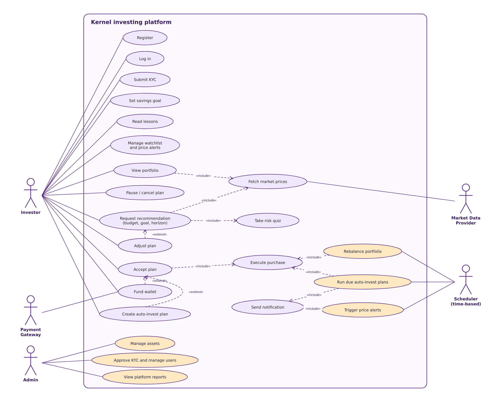
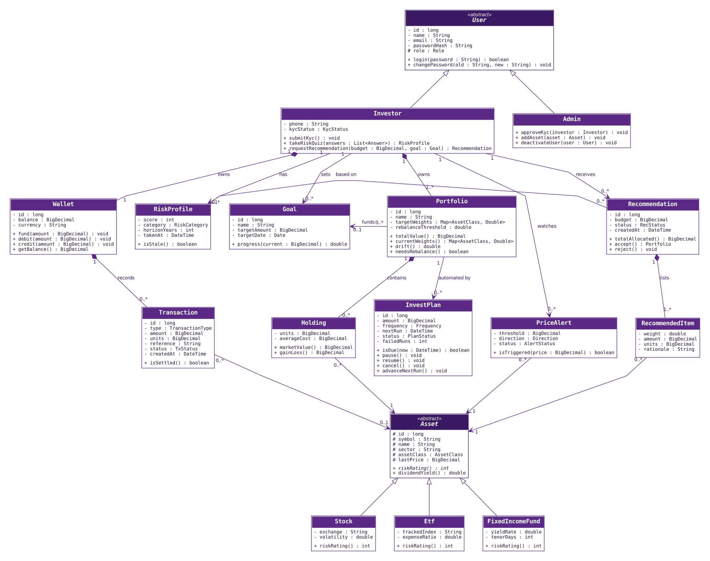

# Kernel

**Smart micro-investing for everyone.** Tell Kernel how much you have, what you are saving for and how much risk you can handle. Kernel recommends a diversified portfolio, explains why, and can invest for you automatically.

> Group 14 project for **CPE434 – Computer Software Engineering I**, Covenant University.
> The prototype uses **simulated trading only**. No real money moves.

---

## Features

**Core**
- Secure sign-up and login
- Wallet funding (payment gateway in test mode)
- Risk quiz that scores your risk profile
- Recommendation engine: enter budget, goal and horizon, get a portfolio across fixed income, Nigerian stocks and US stocks/ETFs, each with a plain-language "Why this?"
- Portfolio view with holdings and value
- Auto-invest plans (weekly or monthly) and round-ups
- Automatic rebalancing when a portfolio drifts more than 5 points

**Extras**
- Savings goals, watchlist and price alerts
- Learning hub, practice mode, dividend tracker, ethical filter
- Admin panel for assets, users and transactions

---

## Tech stack

| Layer | Technology |
|---|---|
| Front end | React / Next.js |
| Back end | Java 21, Spring Boot, Spring Security (JWT), scheduled jobs |
| Database | PostgreSQL |
| Payments | Paystack / Flutterwave (test mode) |
| Market data | Market data API plus sample NGX data |
| Testing | JUnit, Mockito, Postman |
| Hosting | Vercel (front end), Render or Railway (API) |

---

## Architecture at a glance

- **Strategy pattern** for `AllocationStrategy` (Conservative, Balanced, Growth), `MarketDataProvider`, `PaymentGateway` and `Notifier`, so implementations can be swapped without changing the services.
- **Money is never a floating point.** Java `BigDecimal` and PostgreSQL `decimal` are used for all amounts.
- **Plan lifecycle:** ACTIVE → PAUSED / SUSPENDED / COMPLETED / CANCELLED.
- **Transaction lifecycle:** PENDING → SETTLED / FAILED / REVERSED.

---

## UML design

All diagrams are in [`docs/uml`](docs/uml). Editable sources (Mermaid and Graphviz) are in [`docs/uml/src`](docs/uml/src).

| # | Diagram | File |
|---|---|---|
| 1 | Class diagram: domain model | [01-class-domain.png](docs/uml/01-class-domain.png) |
| 2 | Class diagram: recommendation engine | [02-class-engine.png](docs/uml/02-class-engine.png) |
| 3 | Class diagram: automation, payments, notifications | [03-class-automation.png](docs/uml/03-class-automation.png) |
| 4 | Use case diagram | [04-use-case.png](docs/uml/04-use-case.png) |
| 5 | Sequence: request a recommendation | [05-sequence-recommendation.png](docs/uml/05-sequence-recommendation.png) |
| 6 | Sequence: accept a plan and fund the wallet | [06-sequence-accept-plan.png](docs/uml/06-sequence-accept-plan.png) |
| 7 | Sequence: scheduled auto-invest run | [07-sequence-scheduled-run.png](docs/uml/07-sequence-scheduled-run.png) |
| 8 | Activity diagram | [08-activity.png](docs/uml/08-activity.png) |
| 9 | State diagram: InvestPlan | [09-state-invest-plan.png](docs/uml/09-state-invest-plan.png) |
| 10 | State diagram: Transaction | [10-state-transaction.png](docs/uml/10-state-transaction.png) |
| 11 | ER diagram | [11-er.png](docs/uml/11-er.png) |
| 12 | Deployment diagram | [12-deployment.png](docs/uml/12-deployment.png) |

Preview:




---

## Project process

We follow **Scrum** with two-week sprints over 12 weeks. See [scrum.md](scrum.md) for roles, events, the product backlog, the sprint plan and the Definition of Done, and [kanban.md](kanban.md) for the live task board.

---

## Repository structure

```
.
├── README.md
├── scrum.md              Scrum plan and backlog
├── kanban.md             Kanban task board
├── work-breakdown.md     5 parts, owners and Sprint 1 plan
├── .gitignore
├── docs/
│   └── uml/              UML diagrams (PNG) and sources
├── backend/              Spring Boot API (to be added)
└── frontend/             React / Next.js app (to be added)
```

---

## Getting started

> The code folders are added as sprints deliver them. These steps will apply once they exist.

**Prerequisites:** Java 21, Node 20+, PostgreSQL 15+, Git.

```bash
# clone
git clone https://github.com/Apexcod4/Group-14-investment-platform.git
cd Group-14-investment-platform

# back end
cd backend
cp .env.example .env        # set database and gateway test keys
./mvnw spring-boot:run

# front end (new terminal)
cd frontend
npm install
npm run dev
```

Never commit `.env` files or real keys. They are ignored by `.gitignore`.

---

## Team workflow

- One branch per story, named `feature/US-05-recommendations`.
- Open a pull request into `main`. At least one teammate reviews it.
- A story is done only when it meets the Definition of Done in [scrum.md](scrum.md).
- Keep commit messages short and descriptive.

---

## Team

| Name | Role |
|---|---|
| _TBD_ | Product Owner |
| _TBD_ | Scrum Master |
| _TBD_ | Developer |
| _TBD_ | Developer |
| _TBD_ | Developer |

---

## Disclaimer

Kernel is a university prototype for learning purposes. It does not provide financial advice and does not handle real money. A real launch would need SEC Nigeria registration (or a licensed partner) and compliance with the Nigeria Data Protection Act (NDPA).
